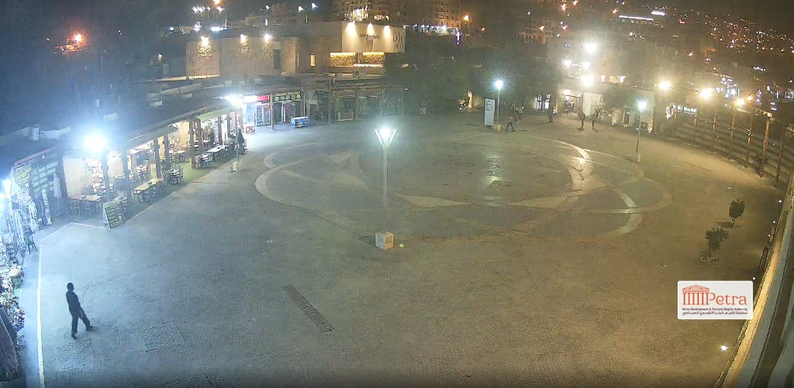

# The Freshman "Elite Hacker"

| | |
|---|---|
| **Event** | TVX CTF 2026 |
| **Category** | OSINT |
| **Challenge** | The Freshman "Elite Hacker" |
| **Points** | 500 |
| **Location** | Petra Visitor Center, Wadi Musa (nearest major city: Amman), Jordan |
| **Flag** | `TVX{30.3243, 35.4678_petra_visitor_center_amman}` |

I had two things for this challenge: a single night screenshot from a webcam and the Skyline Webcams link. The file was called `The Freshman.jpg`.

The link was [Petra - Visitor Center](https://www.skylinewebcams.com/en/webcam/jordan/maan/amman/petra-visitor-center.html).

The screenshot shows a large empty plaza. On the left there are souvenir shops with their lights still on, and a man in dark clothes is walking across the bottom left corner. In the middle of the plaza there is a circular pattern in the paving and a tall lamp post. On the right there is a railing, some trees, and city lights on the hill behind. The bottom right corner has a red logo.



That logo was the first real clue. I cropped it and zoomed in. It says **Petra**, and underneath it: **Petra Development & Tourism Region Authority**. There is Arabic text too. So the place is in Petra, Jordan. The scene is not the Treasury or the Siq; it is a wide open visitor area with shops and a ticket plaza. That fits the entrance to the archaeological site.

The link made it official. The Skyline page is called **Petra - Visitor Center**, and the description says it is a view of the entrance to Petra. The page breadcrumb says `Jordan > Ma'an > Amman`. The visitor center itself is in the small town of Wadi Musa, but the challenge asks for the nearest major city. That is Amman, and Skyline also files the camera under Amman. So the city part of the flag is `amman`.

The camera is number 589 on Skyline. The live frame has the same layout as the screenshot: the curved row of shops on the left, the circular paving, the lamp post, and the fence on the right. The only difference is the time of day. The challenge image is a night frame from that feed.

Next I needed the coordinates. I searched [Google Maps](https://www.google.com/maps/search/?api=1&query=Petra+Visitor+Center) for **Petra Visitor Center**. The pin is at `30.3243487, 35.4678462`, and the address is `28, Wadi Musa, Jordan`. OpenStreetMap gives `30.3242970, 35.4678466`. The flag uses four decimal places, so I rounded to `30.3243, 35.4678`. A tourism page for the visitor center also lists `30.3243° N, 35.4678° E`, which is the same after rounding. That was a good sign.

The flag format was coordinates, then the location name, then the city. The location is the Petra Visitor Center, and the city for the flag is Amman. So the flag is:

```text
TVX{30.3243, 35.4678_petra_visitor_center_amman}
```

I double-checked the place on the map. The visitor center is the starting point for the main trail into Petra, where people buy tickets and begin the walk toward the Siq. The shops, the circular paving, and the railing all match the webcam view. Wadi Musa is the local town, but the flag uses Amman as the nearest major city.

A quick checklist:

- Logo: Petra
- Webcam: Petra - Visitor Center
- Google Maps: `30.3243487, 35.4678462`
- Rounded: `30.3243, 35.4678`
- City for the flag: Amman (local town: Wadi Musa, Ma'an Governorate, Jordan)
- Flag: `TVX{30.3243, 35.4678_petra_visitor_center_amman}`
